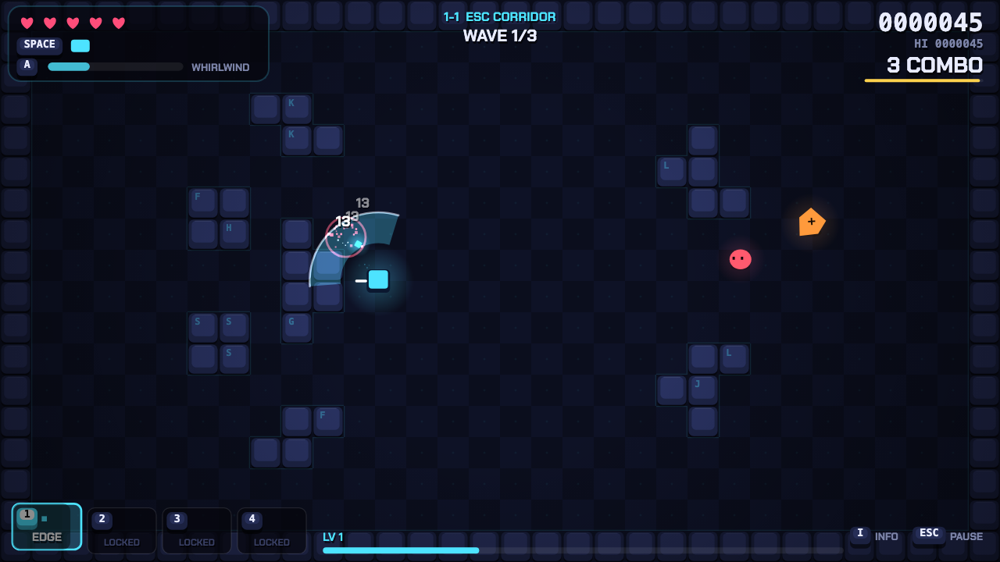

# KEYBLADE

**A fast, keyboard-only arcade survival game.** No mouse. No Tab key. Just you and the keyboard.

Built for [Hack Club Tabbed](https://tabbed.hackclub.com) ("build something keyboard only").

▶ **Play:** https://hc.candygate.eu/tabbed/



You are a tiny keycap with a blade, fighting corrupted keys across three sectors of a keyboard.
Survive waves of enemies, level up, pick upgrades, weave between four weapons, dash through bullets,
beat three bosses, and reach the exit.

## Features

- **3 sectors × 3 arenas**: two procedurally generated wave arenas plus a boss arena per sector
- **7 enemy types**: swarmers, chargers, shooters, bombers, splitters, shielded tanks, summoners
- **3 bosses**: CAPS LOCK (charges and shockwave slams), THE MACRO (bullet spirals and teleports),
  KERNEL PANIC (rotating lasers, bullet walls, homing orbs; three phases)
- **4 weapons on keys 1–4**, each with its own cooldown. Switching triggers a SWAP STRIKE, so
  weaving between weapons is the core skill
- **Dash** with i-frames that damages what you pass through. Dashing through bullets or shockwaves is a
  **perfect dodge** that charges your special
- **4 characters**, each with a unique special on Q (Whirlwind, Overclock, Shockwave, Rewind). One of them has to be unlocked
- XP, leveling, **21 random upgrades plus weapon unlocks and level-ups**, and 2 rerolls per run
- Combo system with multipliers up to x5, score, flawless-wave bonuses
- Pickups: XP, hearts, special batteries, magnets. Caches and sacrifice shrines after each arena
- Local top-10 high scores with arcade-style initials, lifetime stats, unlocks, 4 difficulties
- Screen shake, hit-stop, particles, floating damage numbers, and synthesized sound effects and music
  (WebAudio, no asset files)
- **Reduced-motion mode**: on by default when your OS asks for it
- Key rebinding. Key labels follow your real layout (AZERTY shows ZQSD/A)
- Screen-reader announcements for menus and game events

## Controls

| Key | Action |
| --- | --- |
| **W A S D** / **Arrow keys** | Move (also navigate menus) |
| **SPACE** | Dash (invincible, damages enemies) |
| **E** | Interact (exit portal, cache, shrine). Reroll on the upgrade screen |
| **Q** | Special ability (when the meter is full) |
| **1 / 2 / 3 / 4** | Select weapon. Pick an upgrade card on the level-up screen |
| **ESC** (or **P**) | Pause / back |
| **ENTER** | Confirm |
| **R** | Restart after death |
| **I** | Show / hide game info (your build, and a field guide) |

Menus: **↑/↓** move focus, **←/→** change values, **ENTER** selects, **ESC** or **Backspace** goes back.
Movement, dash, interact, special, info and restart can all be rebound under **Controls**.

> **Why is "info" on I and not TAB?** The official Tabbed rules say: *"You CANNOT use the Tab key."*
> KEYBLADE never uses Tab. Pressing it does nothing, and it can't be bound to anything.

## Run it locally

Requires only a modern browser and Node.js 18+ (the game itself has **zero dependencies** and no build step).

```bash
git clone <this repo> keyblade
cd keyblade
node server.js          # or: npm start
# open http://localhost:5173 and press ENTER
```

Any static server works too (`python3 -m http.server`, etc.). ES modules don't load from `file://`,
so the game has to be served over HTTP rather than opened as a file.

### Deploying

Upload the folder's static files (`index.html`, `style.css`, `src/`) to any static host. Every path is relative,
so it also works from a subfolder (for example `/tabbed/`).

## Keyboard-only test

`tests/keyboard-only.test.mjs` plays the game in a real Chromium using **only keyboard events**. The mouse API
is replaced with a function that throws. It checks menus, rebinding, Tab being ignored, movement, dashing, combat,
the special, pause, info, level-up picks and rerolls, death, high-score entry and restart. It then completes the
entire game (all 9 arenas and 3 bosses) by steering with the arrow keys in a god-mode test build (`?test=god`).

```bash
npm install
npx playwright install chromium   # first time only
npm test                          # QUICK=1 npm test skips the full completion run
```

## Project structure

```
index.html, style.css      page shell (canvas + screen-reader live region)
server.js                  zero-dependency static server
src/
  main.js                  boot
  game.js                  scene stack, loop, scaling, transitions
  config.js                tuning constants
  state.js                 run state (one attempt)
  input.js                 keyboard bindings, rebinding, layout-aware labels (no mouse, Tab swallowed)
  world.js                 arena simulation and the API the entities use
  player.js                movement, dash, weapon switching, specials, interaction
  enemies.js / bosses.js   enemy types and AI state machines
  weapons.js               the four weapons and projectiles
  abilities.js             Q specials
  combat.js                damage, death, combo, score
  hazards.js               shockwaves, lasers, markers, trails
  collision.js             tile collision, line of sight
  levels.js                procedural arenas and the navigation flow field
  waves.js                 wave director
  pickups.js               XP, hearts, batteries, magnets
  upgrades.js              upgrade pool
  progression.js           XP curve, high scores, unlocks, lifetime stats
  effects.js               particles, shake, hit-stop, floating text
  audio.js                 synthesized SFX and music
  render.js                world rendering
  settings.js, storage.js  persisted settings
  ui/                      menus, HUD, overlays, drawing helpers
```

## Hack Club Tabbed compliance

Rules checked on 2026-09-27 at https://tabbed.hackclub.com (FAQ and the submission form at forms.hackclub.com/tabbed).

| Requirement (official wording) | How KEYBLADE meets it |
| --- | --- |
| "Make any app, site, or game that works entirely through the keyboard" | Every screen and action is keyboard-driven: menus, character select, settings, rebinding, pause, upgrades, high-score initials, restart. The game has **no mouse, click, pointer or touch handlers at all**, and the cursor is hidden. |
| "Your project should be fully usable without a touchpad or a mouse" | Open the URL and press ENTER. The page listens on `window` and focuses the canvas itself, so no click is ever needed. This is verified by the automated test, which disables the mouse API. |
| "You CANNOT use the Tab key" | Tab is never used. It is swallowed (so it can't even move browser focus) and it's rejected by the rebinding screen. The TAB "info" key from the original design was moved to **I**. |
| "It should be open source" | MIT-licensed, with the full source in this repository. |
| "…and publicly usable" / "Deploy it somewhere public" / "Playable URL (this must be a live, deployed link)" | Live at https://hc.candygate.eu/tabbed/. It's a static site that works in any modern browser. |
| Code URL | This repository. |
| "Time Spent (Hackatime hours tracked)" | Tracked through Hackatime (WakaTime-compatible editor plugin). |
| Eligibility: ages 13–18 | Applies to the submitter. |

## License

MIT. See [LICENSE](LICENSE).
